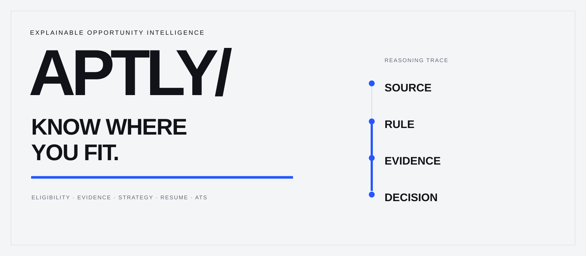
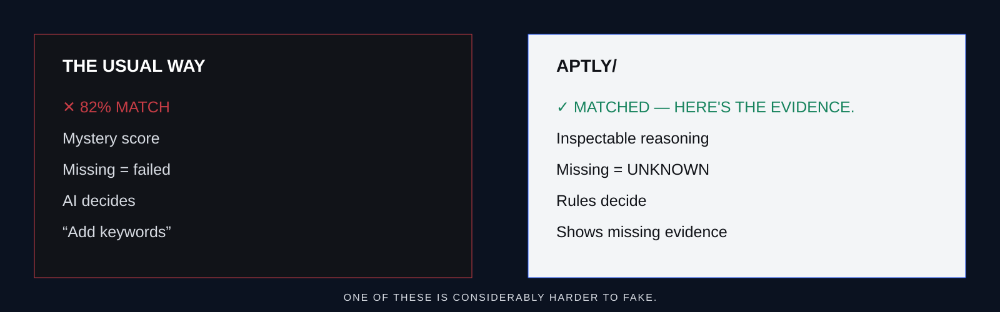
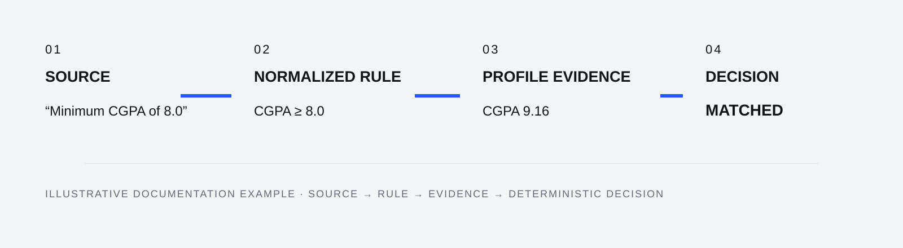
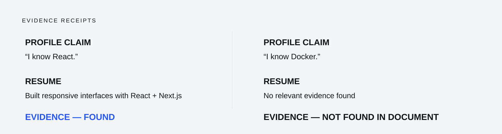
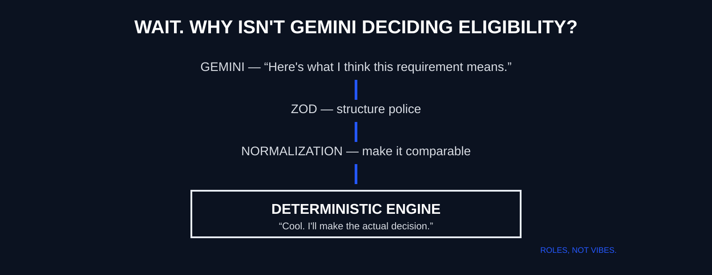
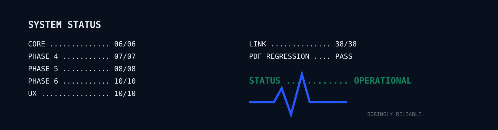

<div align="center"><br><br>

### An explainable opportunity-intelligence system.
**Not just whether you fit. Why.**

[ LIVE EXPERIENCE ](https://aptly-chi.vercel.app/) &nbsp;&nbsp;&nbsp; [ SOURCE ](https://github.com/vedii-codezz/aptly)

   
</div>

<br>

```text
> uploading resume...
> reading opportunity...
> calculating your mysterious 87% AI match score...

ERROR.
APTLY doesn't do mysterious percentages.
```

**Let's try that again.**

# YOUR RESUME SAYS ONE THING.
# THE OPPORTUNITY ASKS FOR ANOTHER.

### APTLY/ connects the evidence.

It compares a candidate’s profile and resume against structured opportunity requirements, then exposes the reasoning behind eligibility, fit, gaps, strategy, resume evidence, and ATS risks.

> A decision without evidence isn't intelligence.<br>
> It's just a number.

<p align="center"></p>

**One of these is considerably harder to fake.**

## 01 / THE SYSTEM

### APTLY/WHAT

```text
OPPORTUNITY → REQUIREMENTS → NORMALIZED RULES
                              ↓
PROFILE EVIDENCE ───── RESUME EVIDENCE
         \                 /
          ↓               ↓
       DETERMINISTIC DECISION
                   ↓
    GAPS · IMPROVEMENT · STRATEGY
```

| ELIGIBILITY | COMPETITIVENESS |
| --- | --- |
| **Can I apply?** | **How strongly do I fit?** |
| Hard constraints | Evidence quality |
| Mandatory requirements | Preferred qualifications |
| Deterministic blockers | Strength indicators |

**Eligible ≠ Competitive.**<br>
**Competitive ≠ Eligible.**

| APTLY DOES | APTLY DOESN'T |
|---|---|
| Trace requirements | Predict recruiters |
| Expose evidence | Invent evidence |
| Admit uncertainty | Turn UNKNOWN into FAILED |
| Find gaps | Manufacture rejection |
| Analyze opportunities | Apply to 700 jobs at 3 AM |

### APTLY/CHECK

### Computers love booleans.
### Careers, inconveniently, do not.

| | |
|---|---|
| **MATCHED** | Evidence satisfies the requirement |
| **PARTIAL** | Evidence exists, but is incomplete |
| **FAILED** | Evidence fails a deterministic rule |
| **UNKNOWN** | Evidence is insufficient |

> **UNKNOWN ≠ FAILED**

```text
UNKNOWN

“I don't have enough evidence.”
Not: “No.”
```

**APTLY would rather be uncertain than confidently wrong.**

`NOTE 01 / UNKNOWN IS A VALID ANSWER.`

Requirements are `MANDATORY`, `PREFERRED`, `BONUS`, or `INFORMATIONAL`.

## 02 / APTLY/WHY

<p align="center"></p>

**Source. Rule. Evidence. Decision.** Every result can be traced backward. Evidence strength stays explicit: `STRONG` · `MODERATE` · `WEAK` · `NOT_FOUND`.

`ILLUSTRATIVE TRACE`
```text
$ aptly trace --requirement "CGPA >= 8.0"
SOURCE FOUND · RULE NORMALIZED · PROFILE EVIDENCE FOUND
DECISION: MATCHED
```

<div align="center"><kbd>SOURCE</kbd> → <kbd>RULE</kbd> → <kbd>EVIDENCE</kbd> → <kbd>DECISION</kbd><br><br><strong>That's the whole obsession.</strong></div>

## 03 / INPUT

| APTLY/LINK | APTLY/RESUME |
|---|---|
| Public opportunity URL | PDF · DOCX · TXT |
| JSON-LD first | Candidate evidence extraction |
| Semantic fallback | Profile/resume comparison |
| Review before analysis | Missing-evidence detection |

```text
        OPPORTUNITY                    CANDIDATE
             │                            │
             └────────────┬───────────────┘
                          ↓
                     APTLY/CHECK
```

APTLY/LINK follows `VALIDATE → FETCH → EXTRACT → STRUCTURE → REVIEW → ANALYZE`. Dynamic or blocked pages may require **Paste Description**; universal website support is not claimed.

<details><summary><strong>APTLY/LINK — security model</strong></summary><br>

Protocol and all-address DNS validation; private/reserved IPv4, IPv6, and IPv4-mapped private IPv6 rejection; redirect revalidation; streamed response limits; timeout; public HTML focus; and untrusted-content handling. External text cannot override eligibility logic.
</details>

## 04 / INTELLIGENCE

APTLY separates fixed constraints from improvable gaps.

```text
GAP → LEARN → PRACTICE → BUILD → PROVE
```

Strategy may recommend **resolve eligibility first**, **fix one thing first**, or **apply now**—from analysis, not a fabricated hiring probability. ATS guidance examines terminology, structure, evidence-backed skills, coverage, bullet quality, and structural risks; it does not predict recruiter outcomes or promote keyword stuffing.

## APTLY/CASE FILE 001

`ILLUSTRATIVE EXAMPLE` — **Software Engineering Intern**

Requirements: CGPA ≥ 8.0 · JavaScript required · React preferred · Docker preferred. Candidate evidence: CGPA 9.16, JavaScript and React project evidence, no Docker evidence found.

```text
CGPA         MATCHED
JavaScript   MATCHED
React        MATCHED
Docker       UNKNOWN

ELIGIBILITY  PASSES KNOWN MANDATORY REQUIREMENTS
NEXT MOVE    Strengthen or document deployment/container experience.
```

<p align="center"></p>

`NOTE 02 / NOT FOUND IN THE DOCUMENT ≠ DOES NOT EXIST.`

## 05 / ARCHITECTURE

```text
UNSTRUCTURED INPUT → GEMINI → STRUCTURED JSON → ZOD → NORMALIZATION
                                                        ↓
                                         DETERMINISTIC CORE
                                                        ↓
                                      EVIDENCE + DECISION
                                                        ↓
                                           EXPLAINABLE REPORT
```

Gemini interprets messy language. The deterministic TypeScript engine decides eligibility. AI may extract, normalize, and explain ambiguity; it is not an authority for final eligibility, mandatory outcomes, or selection probability.

## WAIT. WHY ISN'T GEMINI DECIDING ELIGIBILITY?

Language models are excellent at interpreting messy language. They are considerably less charming when asked to become an unquestionable source of truth.

<p align="center"></p>

<details><summary><strong>Why not just ask Gemini if I'm eligible?</strong></summary><br>

Requirements can be ambiguous, interpretation can vary, and mandatory rules should be reproducible. APTLY uses Gemini to interpret; deterministic logic decides. That separation is intentional.
</details>

### Things APTLY refuses to pretend it knows

- whether a recruiter will like you
- whether you'll get selected
- whether “preferred” secretly means mandatory
- whether a missing resume keyword means you lack the skill
- your mystical 93.72% hiring probability

**Some uncertainty should remain uncertainty.**

## 06 / ENGINEERING

**INTERFACE** — Next.js · React · TypeScript · Tailwind CSS · Framer Motion<br>
**INTELLIGENCE** — Google Gemini API · Zod · deterministic TypeScript engine<br>
**STATE** — Zustand<br>
**DOCUMENTS** — pdf-parse · Mammoth<br>
**DEPLOYMENT** — Vercel

<p align="center"></p>

```text
SYSTEM STATUS
CORE .............. 06/06
PHASE 4 ........... 07/07
PHASE 5 ........... 08/08
PHASE 6 ........... 10/10
UX ................ 10/10
LINK .............. 38/38
PDF REGRESSION .... PASS
STATUS ............ ALL SYSTEMS BORINGLY FUNCTIONAL
```

## 07 / RUN IT

```bash
git clone https://github.com/vedii-codezz/aptly.git
cd aptly
npm install
```

Create `.env.local`:

```bash
GEMINI_API_KEY=your_key_here
```

```bash
npm run dev
```

Open [http://localhost:3000](http://localhost:3000). Without `GEMINI_API_KEY`, deterministic offline/demo analysis remains available.

## 08 / PRINCIPLES

```text
UNKNOWN           ≠ FAILED
ELIGIBILITY       ≠ COMPETITIVENESS
PROFILE EVIDENCE  ≠ RESUME EVIDENCE
INTERPRETATION    ≠ DECISION
AI                ≠ AUTHORITY
SCORE             ≠ EXPLANATION
```

## 09 / NEXT

```text
ANALYZE → SAVE → ANALYZE ANOTHER → COMPARE
```

Future direction: saved analyses, comparison, recurring gap discovery, cross-opportunity skill intelligence, and evidence-improvement tracking.

**The eventual goal: stop opening seventeen internship tabs and pretending you remember which one required Docker.**

<br><div align="center">

### Your resume already contains evidence.
### APTLY/ makes it visible.

[**OPEN APTLY/**](https://aptly-chi.vercel.app/)

<br>

**APTLY/**<br>
Don't just ask if you fit. **Know why.**

Built by **Bedantika Mondal** · [GitHub](https://github.com/vedii-codezz) · [LinkedIn](https://www.linkedin.com/in/bedantikamondal2007/)
</div>

<!-- If you're reading the README source: yes, UNKNOWN still does not mean FAILED. -->
